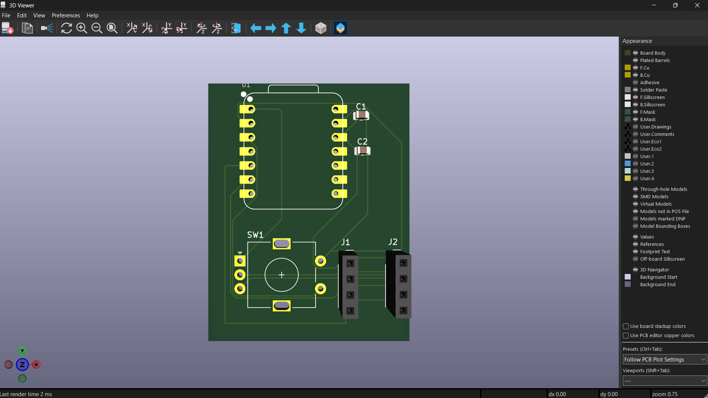
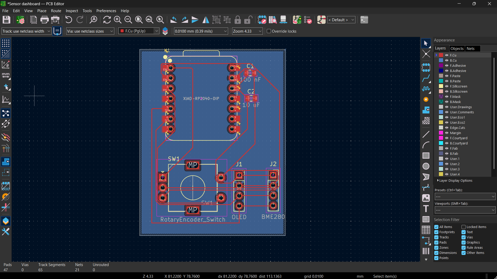
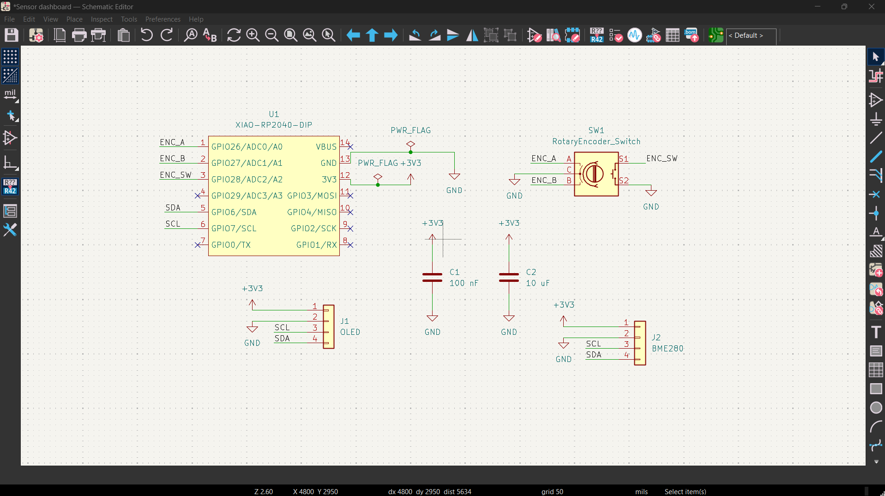

# Sensor Dashboard

A small custom PCB built around a **Seeed XIAO RP2040**. It is designed to read temperature, humidity and air pressure from a **BME280** sensor and show them on a **0.96" OLED** screen, with a **rotary encoder** to switch between pages.

Designed in KiCad for Hack Club **Half Life** (displays week).

---

## Contents

- [Overview](#overview)
- [Features](#features)
- [Pictures](#pictures)
- [How it works](#how-it-works)
- [Pin plan](#pin-plan)
- [Bill of materials](#bill-of-materials)
- [Design decisions](#design-decisions)
- [Design checks](#design-checks)
- [Firmware](#firmware)
- [Building the board](#building-the-board)
- [Known limitations](#known-limitations)
- [Future improvements](#future-improvements)
- [Project files](#project-files)
- [Credits](#credits)

---

## Overview

The Sensor Dashboard is a desk gadget that answers one question: *what is the air around me like right now?*

- A **BME280** measures temperature, humidity and pressure.
- A **0.96" SSD1306 OLED** (128x64 pixels) displays the readings.
- A **rotary encoder** with a push switch lets you change pages and reset values.
- A **XIAO RP2040** runs everything.

The OLED and the sensor plug into sockets on the board instead of being soldered on, so a broken or wrong part can be swapped without redoing the PCB.

## Features

**Designed (hardware, finished):**
- OLED and BME280 sharing one I2C bus (only two microcontroller pins used)
- Rotary encoder with push switch
- Decoupling capacitors on the 3.3 V rail
- Pluggable OLED and sensor modules on 4-pin sockets
- GND fill on the back layer

**Planned (firmware, not written yet):**
- Page 1: live temperature, humidity and pressure
- Page 2: minimum and maximum values since the last reset
- Encoder turn changes the page, encoder press resets min/max
- Optional later: a scrolling 24-hour graph page

## Pictures

### PCB layout

Front copper routing with a GND fill on the back layer.

### Schematic

### 3D view

---

## How it works

**Power.** Everything runs from the XIAO's 3.3 V pin. A 100 nF and a 10 uF capacitor sit between 3V3 and GND to smooth out current spikes when the screen refreshes.

**I2C bus.** The OLED and the BME280 share the same two wires (SDA and SCL). Each device has its own address, so they do not clash:

| Device | I2C address |
|---|---|
| OLED (SSD1306) | `0x3C` |
| BME280 | `0x76` (or `0x77`, depending on the module) |

**Encoder.** The encoder's A and B outputs go to two GPIO pins, and its common pin goes to GND. The push switch uses a third GPIO pin and GND. The firmware is meant to use the RP2040's internal pull-ups, so no external resistors are needed.

**Sockets.** Both modules use the same 4-pin pin order, so they can share one footprint:

| Pin | Signal |
|---|---|
| 1 | 3V3 |
| 2 | GND |
| 3 | SCL |
| 4 | SDA |

> Always check the labels printed on your module before plugging it in. Pin order varies between sellers, and swapping VCC and GND can damage a module.

## Pin plan

XIAO RP2040 connections as drawn in the schematic:

| Signal | XIAO pin | RP2040 GPIO | Goes to |
|---|---|---|---|
| ENC_A | D0 | GPIO26 | Encoder A |
| ENC_B | D1 | GPIO27 | Encoder B |
| ENC_SW | D2 | GPIO28 | Encoder push switch |
| SDA | D4 | GPIO6 | OLED and BME280 |
| SCL | D5 | GPIO7 | OLED and BME280 |
| 3V3 | 3V3 | - | Sockets and capacitors |
| GND | GND | - | Everything |

Unused XIAO pins are marked as no-connect in the schematic, and VBUS (5 V) is not used.

## Bill of materials

| Ref | Qty | Part | Footprint / notes |
|---|---|---|---|
| U1 | 1 | Seeed XIAO RP2040 | `XIAO-RP2040-DIP` |
| J1 | 1 | 4-pin 2.54 mm pin socket (for OLED) | `PinSocket_1x04_P2.54mm_Vertical` |
| - | 1 | 0.96" 128x64 I2C OLED, SSD1306, 4-pin | Plugs into J1, address 0x3C |
| J2 | 1 | 4-pin 2.54 mm pin socket (for BME280) | `PinSocket_1x04_P2.54mm_Vertical` |
| - | 1 | BME280 I2C module, 4-pin (VIN, GND, SCL, SDA) | Plugs into J2. Make sure it is BME280, not BMP280 (BMP280 has no humidity) |
| SW1 | 1 | EC11 rotary encoder with push switch | `RotaryEncoder_Alps_EC11E-Switch_Vertical_H20mm` |
| C1 | 1 | 100 nF capacitor, 0805 | `C_0805_2012Metric` |
| C2 | 1 | 10 uF capacitor, 0805 | `C_0805_2012Metric` |

## Design decisions

- **Why an OLED?** It only needs four wires over I2C, has high contrast, and is simple to design around compared to a colour TFT, LED matrix or NeoPixels, which need more wiring, level shifting or power planning.
- **Why a BME280 module and not the bare chip?** The bare BME280 is a tiny LGA package that is very hard to solder by hand. A ready-made module keeps the PCB simple and the sensor replaceable.
- **Why sockets?** Plug-in modules mean a dead OLED or sensor can be swapped in seconds.
- **Why a XIAO RP2040?** It is small, has hardware I2C on D4/D5, runs on 3.3 V logic, and works with CircuitPython and Arduino.
- **Why 3.3 V for everything?** All parts accept 3.3 V, and the OLED module's pull-ups connect to VCC, so using 3.3 V keeps the I2C lines safe for the RP2040.

## Design checks

- **Electrical Rules Check (schematic):** run after fixing annotation and adding power flags.
- **Design Rules Check (PCB):** 0 errors, 0 unconnected items.
- The remaining DRC warnings are silkscreen-related (silkscreen overlapping pads or touching the board edge). They do not affect the copper or whether the board works.

## Firmware
The board runs on CircuitPython.

Required Libraries
Ensure the following Adafruit CircuitPython driver libraries are copied to your board's lib folder:

adafruit_displayio_ssd1306

adafruit_display_text

adafruit_bme280

i2cdisplaybus

Main Script (code.py)

## Building the board

Planned assembly steps:

1. Order the PCB from the exported Gerber files.
2. Solder the two capacitors (C1, C2).
3. Solder the encoder (SW1) and the two 4-pin sockets (J1, J2).
4. Solder the XIAO (U1) in place, or use sockets for it.
5. Plug in the OLED and the BME280 module, checking pin order first.
6. Copy the firmware to the board and power it over USB-C.

## Known limitations

- Firmware is not written yet.
- No mounting holes for the OLED yet.
- Board outline is a simple rectangle.
- Silkscreen warnings remain in DRC (cosmetic only).
- No battery or charging circuit.

## Future improvements

- Add mounting holes for the OLED and a case
- 24-hour scrolling graph page
- Battery, charging circuit and deep sleep for portable use
- Add a soil moisture sensor for a plant monitor version
- Clean up silkscreen labels

## Project files

- KiCad project, schematic and PCB files (`.kicad_pro`, `.kicad_sch`, `.kicad_pcb`)
- Footprint and symbol libraries used by the design
- `sensor-dashboard.png`, `pcb-design.png`, `Schematics.png` (images used in this README)

## Credits

- Built following the Hack Club Half Life OLED display guide as a reference.
- KiCad for the schematic and PCB design.
